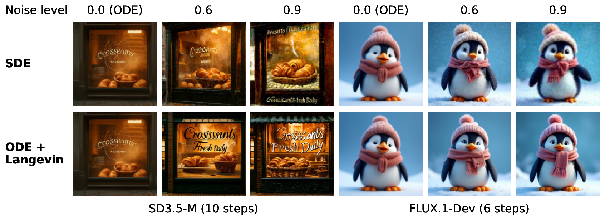
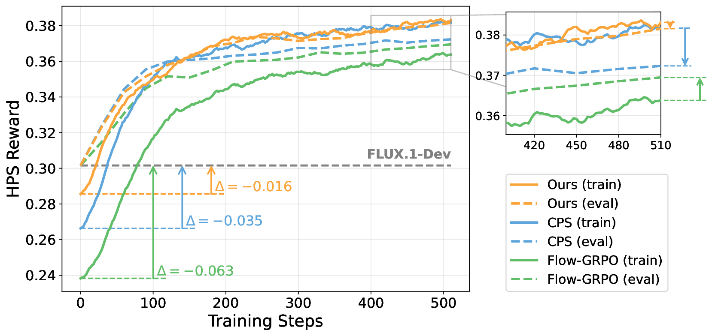
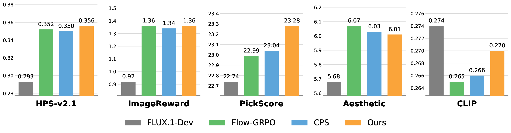

<h1 align="center"> LC-GRPO:<br>Bridging Train-Inference Gap for Flow-Based GRPO with Langevin Correction </h1>

<p align='center' style="text-align:center;font-size:1.25em;"> 
    <a href="https://scholar.google.com/citations?user=vfVcl2YAAAAJ&hl=en" target="_blank" style="text-decoration: none;">Yingqing Guo</a>, &nbsp;
    <a href="https://hhhhuiyuan.github.io" target="_blank" style="text-decoration: none;">Hui Yuan</a>, &nbsp; 
    <a href="https://www.linkedin.com/in/hezijian/" target="_blank" style="text-decoration: none;">Zijian He</a>, &nbsp; 
    <a href="https://mwang.princeton.edu/" target="_blank" style="text-decoration: none;">Mengdi Wang</a>,&nbsp;
    <a href="https://scholar.google.com/citations?user=TOYBXFQAAAAJ&hl=en" target="_blank" style="text-decoration: none;">Zheng Ding</a>&nbsp;
     <br/> 
</p>

<div align="center">
  <a href="https://arxiv.org/abs/2608.05600"></a> &nbsp;
  <a href="https://github.com/yingqing001/LC_GRPO"></a>
</div>


## Introduction

Applying reinforcement learning to flow models creates a fundamental conflict:

- Inference uses a **deterministic** ordinary differential equation (ODE).
- RL rollouts must be **stochastic** to enable *exploration*.

Although theoretically equivalent to the ODE formulation, a stochastic
differential equation (SDE) formulation produces low-quality samples when only
a few sampling steps are used. We address this conflict by combining ODE
sampling with Langevin correction steps, enabling stochastic exploration while
preserving rollout quality and narrowing the gap between training and inference.

<p align="center">
  
</p>
<p align="center"><i>
Sampling Method Comparison. As the noise level increases, SDE-based sampling
degrades sample quality, whereas ODE sampling with Langevin correction preserves sample clarity
</i></p>

<p align="center">
  
  
</p>
<p align="center"><i>
Performance of LC-GRPO. Top: Langevin correction narrows the gap between
stochastic RL rollouts and ODE inference at test time, giving LC-GRPO the
smallest training–evaluation gap. Bottom: evaluation results on DrawBench.
</i></p>

## 🖼️ Image Generation

We conduct image-generation experiments on SD3.5-Medium and
FLUX.1-Dev. See the [image-generation README](image_gen/README.md) for details.

## 🎬 Video Generation

We conduct video-generation experiments on HunyuanVideo. See the
[video-generation README](rl_grpo_video/README.md) for details.

## Citation

If LC-GRPO helps your work, please cite:

```bibtex
@article{guo2026lc,
  title={LC-GRPO: Bridging Train-Inference Gap for Flow-Based GRPO with Langevin Correction},
  author={Guo, Yingqing and Yuan, Hui and He, Zijian and Wang, Mengdi and Ding, Zheng},
  journal={arXiv preprint arXiv:2608.05600},
  year={2026}
}
```
